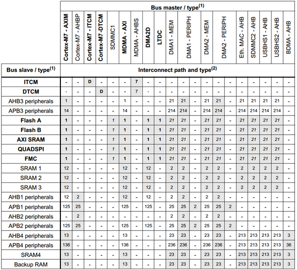

# 【扩展】H7引入的概念与问题

> Ver1.0  
> 本章编者：李融

> 实验室最常使用的MCU实际上是H7，H7性能更强，而特性也相对更加复杂，这就引入了许多新特性和要注意的问题。安富莱制作过一个比较全面的H7针对性教程，有兴趣大家可以阅读：
> [【安富莱】STM32H7用户手册发布](https://forum.anfulai.cn/forum.php?mod=viewthread&tid=86980)

## 内存结构和DMA可达性
- [【STM32H7教程】第25章 STM32H7的TCM，SRAM等五块内存基础知识 - 硬汉嵌入式](https://www.cnblogs.com/armfly/p/11014230.html)

最近开发软件框架的时候，遇到一个神秘问题。框架使用GCC，在配置好串口之后，中断接收正常工作，但是DMA接收缺收不到任何东西。经过一段时间排查之后，发现是DMA的可达性问题。

这个问题要先从H7系列MCU的内存架构说起。
回忆[内存布局](2.1%20引入和内核.md#内存布局)一节：F103的SRAM只有一块，挂在AHB上，CPU和DMA1谁都能访问。H7把这个模型则不同，芯片按总线分成三个域：D1域走高速AXI总线，挂CPU和主SRAM（AXI SRAM）；D2域走AHB，挂DMA1/DMA2和大部分外设；D3域是低速区，挂着SRAM4和BDMA。更大的不同是，M7内核还带了两块**私有小内存**：ITCM放代码、DTCM放数据，它们直连内核、零等待访问，但**根本不在任何共享总线上**。



通过这个总线互联图，要了解到下面三个重要知识点：
1.   DTCM和ITCM不支持DMA1，DMA2和BDMA，仅支持MDMA。
2.   AXI SRAM，SRAM1，SRAM2，SRAM3不支持BDMA，支持MDMA，DMA1和DMA2。
3.   SRAM4支持所有DMA，即MDMA，DMA1，DMA2和BDMA。

于是逻辑就完整了。缓冲区变量被分配在DTCM（`0x2000xxxx`），DMA收到数据往里写时触发总线错误、TEIF置位、DMA停工；而IDLE中断在UART侧产生、不依赖DMA是否成功，照常触发。

如果你用Keil开发过H7的开发板，可能会发现你的DMA接收并没有这个问题，默认分配的内存buffer好像可以正常工作。这个原因主要是工具链使用的连接器的默认策略问题，这就要从连接器的工作方式讲起。

编译器产出的每个`.o`文件里，代码和数据都按**输入段**组织（`.text`、`.data`、`.bss`，以及`__attribute__((section(...)))`自定义的段）。这些段只有名字和内容，**没有地址**。接下来，**链接器**把所有`.o`里的同名输入段收集合并成**输出段**，按照链接脚本给每个输出段分配最终地址。脚本里的`MEMORY`命令声明芯片有哪些物理内存区域（名字、起始地址、大小），`SECTIONS`命令则规定哪个输出段放进哪个区域。

GNU ld和Keil的armlink的规则不太相同。CubeMX给GCC/CMake工程生成的`.ld`模板，把`.data/.bss`**显式绑定**到了`RAM`区域，而这个区域默认定义为DTCMRAM，就会触发问题。armlink用的是另一套格式（分散加载文件`.sct`，由Target对话框的内存配置自动生成）：Keil的设备包把DTCM（IRAM1）和AXI SRAM（IRAM2）**都预定义为可用内存**，`.sct`里于是平级地开着两个接收`RW/ZI`的执行区。armlink面对多个区域都写着`.ANY(+RW +ZI)`时，默认按**worst_fit**策略摆放：段优先进当前剩余空间最大的区域，320KB的AXI SRAM自然压过128KB的DTCM。

GCC工程（CubeMX生成的`STM32H723XG_FLASH.ld`）在`MEMORY`里声明了四个区域，而`.data`和`.bss`全部绑定到`>DTCMRAM`：

```ld
MEMORY
{
  DTCMRAM (xrw) : ORIGIN = 0x20000000, LENGTH = 128K
  RAM_D1  (xrw) : ORIGIN = 0x24000000, LENGTH = 320K
  RAM_D2  (xrw) : ORIGIN = 0x30000000, LENGTH = 32K
  /* ... */
}
/* SECTIONS 里： */
.data : { ... } >DTCMRAM AT> FLASH
.bss  : { ... } >DTCMRAM
```

CUBE生成的Keil工程中，注意它把**两个**RAM区都给了RW/ZI数据：

```ld
LR_IROM1 0x08000000 0x00100000  {
  ER_IROM1 0x08000000 0x00100000  {
    *.o (RESET, +First)
    *(InRoot$$Sections)
    .ANY (+RO)
  }
  RW_IRAM1 0x20000000 0x00020000  {   ; DTCM，128K
    .ANY (+RW +ZI)
  }
  RW_IRAM2 0x24000000 0x00050000  {   ; AXI SRAM，320K
    .ANY (+RW +ZI)
  }
}
```

两个区都写着`.ANY (+RW +ZI)`，意味着变量理论上可以进DTCM也可以进AXI。这个时候，armlink按worst_fit把段放进剩余空间最大的区，320KB的AXI SRAM压过128KB的DTCM，绝大多数变量于是落进了`0x2400xxxx`。

所以，其实是摆放算法救了你。无论哪个工具链，变量最终分配到了哪里最终可以查验map文件，只要是`0x2000xxxx`开头就必须处理。

**最根本的解决办法也很简单**，给 DMA 缓冲打上独立 section，用链接脚本绑定到 AXI SRAM，并手动将脚本分配到指定数据段：

```cpp
static uint8_t buf[kSize]
    __attribute__((section(".dma_staging"), aligned(32)));
```

```ld
SECTIONS
{
  .dma_staging (NOLOAD) : { *(.dma_staging) } >RAM_D1
}
```

使用独立 `.ld` 片段配合 `-T` 追加到链接选项，可以避免被 CubeMX 重新生成代码时覆盖。

