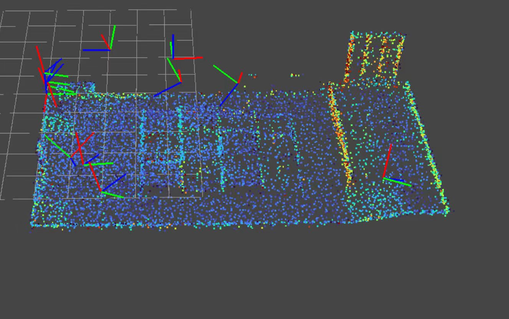

# 什么是 SLAM，包括什么，有哪些 SLAM

SLAM 是同时定位与建图（Simultaneous Localization and Mapping）。机器人用当前观测和地图做匹配，估计自己在哪里。要把这次看到的墙面或特征放进地图，又得知道采集这一帧时机器人的位置和朝向。SLAM 联合估计这两个未知量，输出机器人沿途的位姿和环境地图。

## 从相邻两帧到整张地图

| 环节 | 处理什么 | 得到什么 |
| --- | --- | --- |
| 前端 | 跟踪图像特征或光流，用 ICP 等方法对齐点云 | 相邻时刻的相对位姿 |
| 后端 | 用滤波、光束法平差（BA）、位姿图或因子图综合观测约束 | 校正后的轨迹 |
| 回环 | 识别再次经过的地点，为相距较远的两段轨迹添加约束 | 供后端校正累计误差的依据 |
| 地图 | 把观测组织为稀疏特征点、点云、栅格或截断有符号距离场（TSDF） | 可用于定位、规划或可视化的环境表示 |

**里程计能报告走了多远、转了多少，但连续积分或配准会积累误差。** 例如，机器人绕场一圈回到出发处，前端可能把终点放在起点旁边。回环把两次观测联系起来，全局优化才能利用这条约束调整整段轨迹，最终让轨迹闭合。[里程计与累计漂移](./07-里程计与累计漂移.md)

## 按传感器区分里程计

| 类型 | 使用的观测 | 算法示例 |
| --- | --- | --- |
| VO（视觉里程计） | 相机图像 | ORB-SLAM2 的视觉跟踪 |
| LO（激光里程计） | 激光雷达点云或扫描 | LeGO-LOAM 的激光前端。二维激光系统也常见 Cartographer |
| VIO（视觉惯性里程计） | 图像与 IMU | ORB-SLAM3 的视觉惯性模式 |
| LIO（激光惯性里程计） | 激光雷达与 IMU | FAST-LIO2、Point-LIO、LIO-SAM、GLIM |
| LIVO（激光视觉惯性里程计） | 激光雷达、相机与 IMU | FAST-LIVO2。GLIM 也可引入视觉约束，其中的视觉约束实现尚未开源 |

ROBOCON 场地常用三维激光方案，其中 LIO 用点云约束位姿、用 IMU 跟踪两次扫描之间的运动。评估精度时，要看场地给了传感器什么信息。遇到几何结构单一、激光配准容易退化的区域，图像特征可以补充约束。视觉跟踪本身也受场景影响。LIVO 可以同时利用这些观测，但还要承担图像处理的算力开销。但往往引入视觉约束提升的精度有限，却会带来更高的算力资源开销，并不划算，因此在RC中，我们更推荐使用LIO类的里程计算法。精度较高，性能需求不算特别高。
