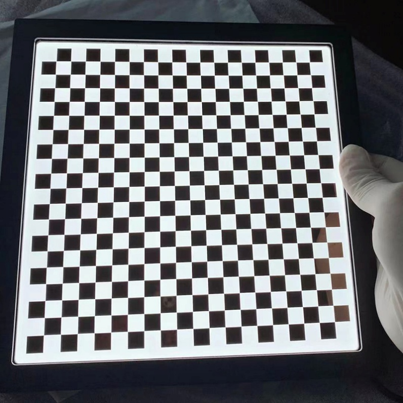

# 传感器靠什么保持一致：标定与温漂与同步

机器人转弯时，雷达、相机和 IMU 即使牢牢固定在同一个支架上，看到的也是各自坐标系、各自采样时刻的运动。融合之前要知道它们之间相差多远、朝向如何，以及每条观测究竟来自哪个时刻。

## 激光雷达内参外参标定与标定

以相机为例，焦距、主点和畸变等内参决定了怎样把三维点投到图像上。外参则描述两台设备之间的相对平移和旋转。许多内参在出厂时测定，装上机器人后，队伍还需要确定传感器之间以及传感器相对车体的外参。

标定涉及四组量。先确认各传感器的**内参**，再估计设备之间的**外参**。融合时还要处理设备之间的**时间偏移**，并用**噪声参数**给残差分配权重。实际工具可以联合估计其中几项，例如 Kalibr 能同时求相机与 IMU 的外参和时延。

| 传感器组合 | 标定方法 | 采集条件与验收示例 |
| --- | --- | --- |
| 相机与 IMU | Kalibr 用连续时间 B 样条描述轨迹，结合重投影和惯性残差估计外参、时延 | 六轴都要有充分激励，时间戳可信，图像运动模糊小。可比较两次独立标定的结果，例如平移差小于 5 mm、旋转差小于 0.3° |
| 激光雷达与 IMU | LI-Init 类工具可联合估计外参、时延、重力和零偏，也可用靶标或手眼标定 $AX=XB$ | 采集多轴旋转与平移，对比去畸变前后同一面墙的点云厚度 |
| 激光雷达与相机 | 用棋盘格、平面、孔洞或 ArUco 靶标，也可用互信息或边缘对齐做无靶标标定 | 保证共同视野与足够的点云密度。平面法示例使用至少 3 个非共面平面，投影边缘偏差参考值为 2–3 px 以内 |
| 双目或多相机 | 立体标定，联合估计内参和相对旋转、平移 | 同步曝光并保持共同视野，可用小于 0.3 px 的极线误差作验收参考 |
| 多激光雷达 | 靶标法或基于运动的手眼标定 | 保留重叠视野，采集充分的旋转，用重叠区的点云厚度检查结果 |
| 轮速、舵角或 GNSS 杆臂 | 尺量获得初值，再用最小二乘或手眼标定细化 | 采集能充分激励参数的车辆运动，用轨迹闭合差和航向一致性检查 |

手持棋盘格标定板，黑白方格的交点用于图像角点检测

IMU 的噪声可用 Allan 方差分析。使用 `imu_utils` 的结果时要格外注意单位，尤其要确认加速度、重力常数及噪声参数是否符合算法的输入约定。[常见坑点：物理单位](./10-物理单位.md)

## 雷达散热与温漂

雷达温度极端会影响雷达的imu数据，高温还会影响雷达内部处理芯片处理点云数据的性能，因此雷达温度不可被忽视。Mid-360 低温时会主动加热（一般情况下不需要额外处理），过热则会定位效果变差，在日常使用场景中应当以约 70 °C 作为判断是否需要额外散热的参考。另外风扇也会给支架引入振动，如果使用某些比较依赖IMU稳定性的算法，会让定位效果更差。装风扇前应先看设备实际温度和 对IMU 数据的要求，也可以使用导热介质（相变片、导热凝胶）加散热鳍片实现散热，不影响imu效果。
经验之谈：大部分场景不需要给雷达专门做散热。雷达很难达到70度以上。

不同型号的出厂温漂补偿情况不同。以 SkylandX C01 为例，队内曾用连续采集 20 分钟的数据包绘制 IMU 曲线，观察同一台雷达在这段时间里的测量变化。然后通过标定数据，重新标定imu来提升定位效果。

## 硬同步与软同步——为什么RC强队都应该有这个技术栈

**硬同步**用硬件信号控制采样时刻，或给设备提供共同的时间基准。例如，双目相机可以用同一个脉冲触发曝光；雷达和 IMU 则可以按各自的频率采样，用同一时间基准记录采样时刻。PTP、gPTP 用于对齐设备时钟，PPS 提供秒脉冲参考。这样更容易控制时间误差，但传感器和驱动都要支持相应的同步方式。

**软同步**由软件按时间戳对齐数据。例如，把雷达点和 IMU 的采样时间换算到同一时间轴后，可以用相邻的 IMU 数据估计采到这个点时的姿态。软同步接入方便，通常不用额外接触发线。如果驱动用主机收包时刻代替采样时刻，传输和调度的抖动也会算进时间差，机器人快速转弯时就容易出现点云重影。
